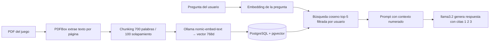

# 🎮 GameStats AI — RAG para Videojuegos

Sistema **RAG (Retrieval-Augmented Generation)** que permite subir PDFs de **cualquier videojuego**
(patch notes, guías, lore, wikis, estadísticas) y hacerle preguntas a una IA que responde
**citando la página exacta** de donde sacó la información. Todo corre **localmente** con Ollama.

## 🧱 Tecnologías

| Capa | Tecnología |
|------|------------|
| Backend | Java 21 + Spring Boot 3.5 |
| Seguridad | Spring Security + JWT + BCrypt |
| Base de datos | PostgreSQL 16 + **pgvector** (búsqueda vectorial, índice HNSW) |
| Migraciones | Flyway |
| Lectura de PDF | Apache PDFBox 3 |
| IA (local) | Ollama: `nomic-embed-text` (embeddings 768d) + `llama3.2:3b` (LLM) |
| Frontend | HTML + CSS + JavaScript (servido por Spring en `/`) |

## 🔄 ¿Cómo funciona?



## 🚀 Cómo ejecutarlo

**Requisitos:** Java 21, Maven, Docker, [Ollama](https://ollama.com).

```bash
# 1. Base de datos con pgvector
docker compose up -d

# 2. Modelos de IA
ollama pull nomic-embed-text
ollama pull llama3.2:3b
ollama serve          # si no está corriendo ya

# 3. Backend + frontend
mvn spring-boot:run
```

Abrir **http://localhost:8080** → registrarse → subir un PDF → preguntar.

## 📡 API REST

| Método | Endpoint | Auth | Descripción |
|--------|----------|------|-------------|
| POST | `/api/auth/register` | ❌ | Crear cuenta → devuelve JWT |
| POST | `/api/auth/login` | ❌ | Iniciar sesión → devuelve JWT |
| POST | `/api/documents` | ✅ | Subir PDF (multipart: `file`, `name`, `gameName`) → 202 |
| GET | `/api/documents` | ✅ | Listar mis documentos y su estado |
| DELETE | `/api/documents/{id}` | ✅ | Eliminar documento y sus fragmentos |
| POST | `/api/query` | ✅ | `{ "question": "..." }` → respuesta + fuentes |

Ejemplo:
```bash
TOKEN=$(curl -s -X POST localhost:8080/api/auth/login -H 'Content-Type: application/json' \
  -d '{"username":"filip","password":"123456"}' | jq -r .token)

curl -X POST localhost:8080/api/documents -H "Authorization: Bearer $TOKEN" \
  -F file=@patch_notes.pdf -F gameName=Valorant

curl -X POST localhost:8080/api/query -H "Authorization: Bearer $TOKEN" \
  -H 'Content-Type: application/json' -d '{"question":"¿Qué agentes recibieron nerfs?"}'
```

## 📁 Estructura

```
src/main/java/com/gamestats/rag/
├── RagApplication.java          # Arranque (@EnableAsync)
├── config/                      # Seguridad, BCrypt, cliente HTTP de Ollama
├── security/JwtAuthFilter.java  # Valida el token en cada petición
├── model/                       # Entidades JPA: User, Document, DocumentChunk
├── repository/                  # Acceso a datos + consulta vectorial (<=>)
├── dto/                         # Objetos de entrada/salida de la API
├── service/                     # Lógica: PDF, chunking, embeddings, RAG, JWT
└── controller/                  # Endpoints REST + manejo de errores
src/main/resources/
├── application.yml
├── db/migration/                # V1 users, V2 documents, V3 chunks + pgvector
└── static/index.html            # Frontend
```

## 🔐 Seguridad y privacidad

- Contraseñas con **BCrypt**; autenticación **JWT** sin sesiones.
- **Multi-tenant:** la búsqueda vectorial filtra por `user_id` → nadie ve documentos ajenos.
- **El PDF nunca se guarda:** se borra al terminar la indexación; solo quedan fragmentos + hash SHA-256.
- La IA corre **local** (Ollama): ningún dato sale de tu máquina.
