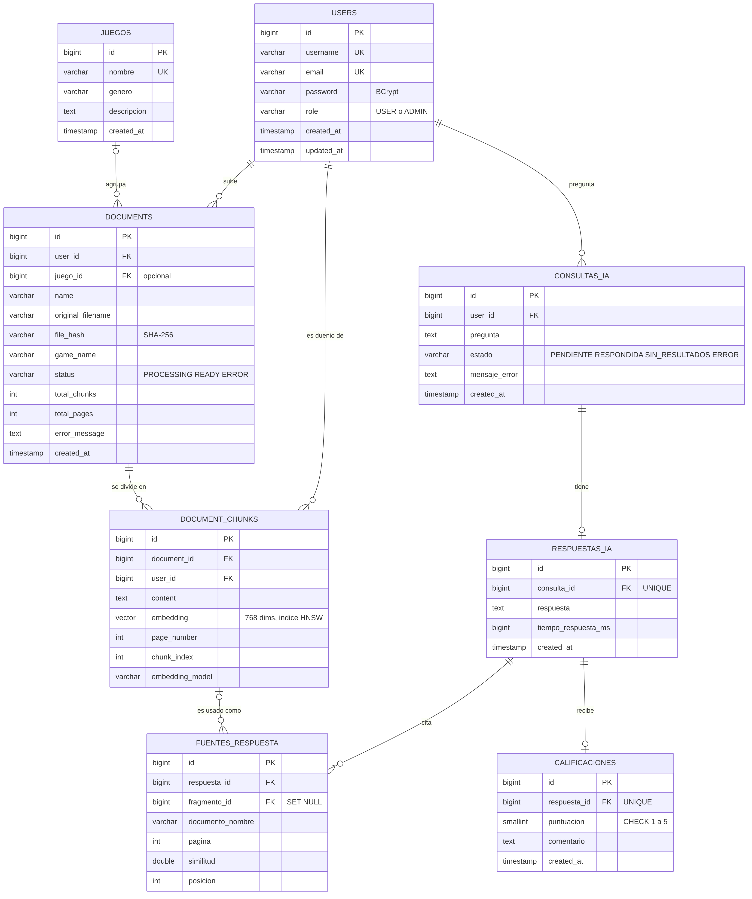
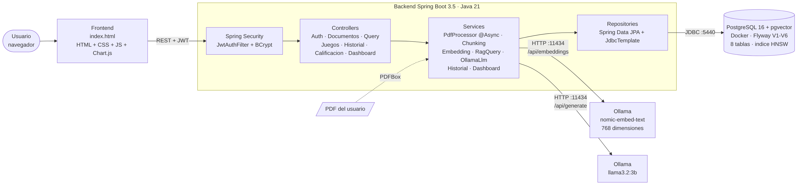
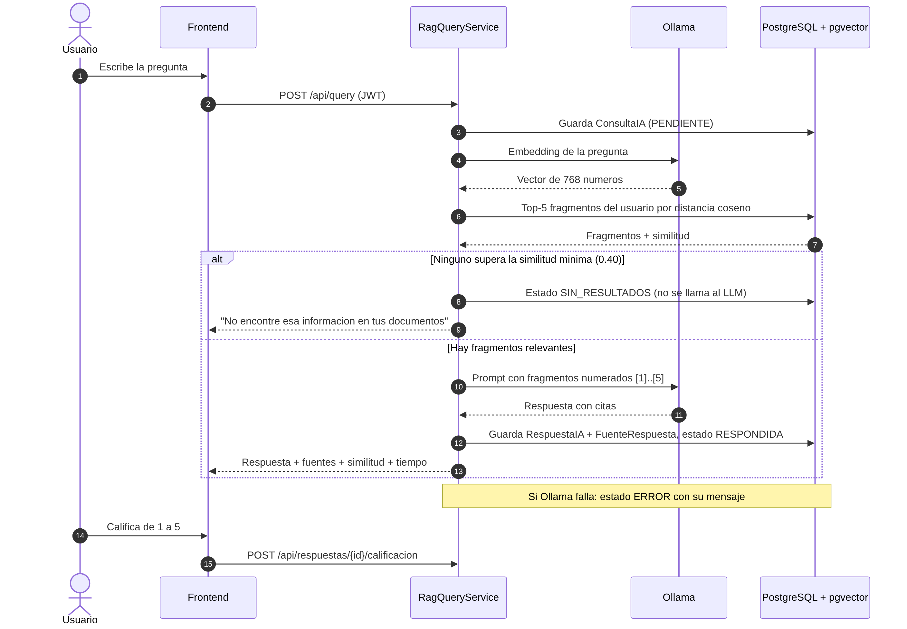

# Diagramas de GameStats AI

Las imágenes están en `docs/diagramas/`. El código fuente de cada diagrama (Mermaid) está al lado, en el archivo `.mmd`, por si hay que modificarlo.

## 1. Modelo entidad-relación

8 tablas, creadas con Flyway (V1 a V6).

| Relación | Tipo | Al borrar el padre |
|---|---|---|
| users → documents, document_chunks, consultas_ia | 1 a muchos | `CASCADE` |
| juegos → documents | 1 a muchos (opcional) | `SET NULL` |
| documents → document_chunks | 1 a muchos | `CASCADE` |
| consultas_ia → respuestas_ia | 1 a 1 (`UNIQUE`) | `CASCADE` |
| respuestas_ia → fuentes_respuesta | 1 a muchos | `CASCADE` |
| document_chunks → fuentes_respuesta | 1 a muchos (opcional) | `SET NULL`, el historial se conserva |
| respuestas_ia → calificaciones | 1 a 1 (`UNIQUE`) | `CASCADE` |

Restricciones `CHECK`: estado de la consulta (4 valores), puntuación entre 1 y 5 y similitud entre -1 y 1.

## 2. Arquitectura

El frontend solo habla con Spring Boot. Spring Boot es el único que accede a PostgreSQL y a Ollama.

## 3. Flujo de una consulta RAG

